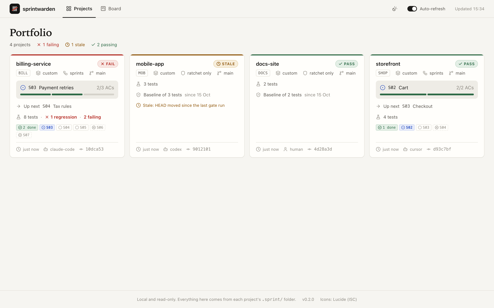
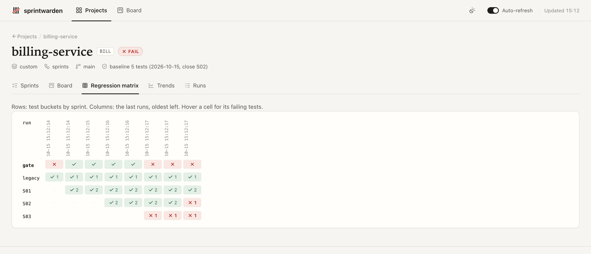

# sprintwarden

**Your AI agent can't silently delete, skip or break your old tests anymore, on any stack.**

[](https://github.com/sprintwarden/sprintwarden/actions/workflows/ci.yml)
[](https://pypi.org/project/sprintwarden/)


[](LICENSE)



Coding agents lose context between sessions, and under pressure to finish they
sometimes **delete, skip or weaken a failing test** and report "done". sprintwarden
is a **test ratchet**: it snapshots every test your project has today, and from then
on the gate fails if any of them disappears, is newly skipped or fails, until a
*human* accepts it with a reason. It works with any runner that writes JUnit XML
and any agent that can run a shell command.

## 2-minute quickstart

```sh
pipx install sprintwarden          # or: uvx sprintwarden ...
cd your-repo
sprint init --ratchet-only         # detects the stack, runs the suite, writes the baseline
git add -A && git commit -m "Add sprintwarden test ratchet"
```

That's it. From now on:

| | |
|---|---|
| `sprint gate` | runs the full suite and checks the ratchet (exit 1 on failure) |
| **Claude Code** | can't end its turn while the gate fails (Stop hook, installed by `init`) |
| **any agent** | reads the rules in `AGENTS.md` (generated) |
| **git push** | is blocked while the gate fails (pre-push hook; `SPRINT_SKIP=1` bypasses, and is recorded) |
| **CI** | `uses: sprintwarden/sprintwarden@v1` is the final authority |

## What the gate checks

```
sprintwarden gate — billing-service — S03 (Reports)
✓ runner     412 tests parsed from 3 files (38.2s)
✗ failures   2 failing (1 regression)
     S01    AuthTest.S01_lockoutAfter5Attempts      ← REGRESSION from sprint S01
     S03    ReportExportTest.S03_exportsPdf
✗ missing    1 test missing vs baseline
     S02    InvoiceTest.S02_roundsToPaise           ← deleted or renamed? use `sprint accept-removal` (human only)
✓ skips      no new skips
✓ ratchet    412 ≥ 398 (+14 new)
  ACs        AC1 ✗  AC2 ✓
GATE: FAIL
```

| check | fails when |
|---|---|
| runner | no JUnit XML was produced, a report is unreadable, or the runner crashed without failing tests (build error) |
| failures | any test fails: current sprint, earlier sprints or legacy |
| missing | a baseline test no longer exists and no human accepted its removal |
| skips | a test is skipped now that wasn't in the baseline, and no human allowed it |
| ratchet | total tests < baseline total − accepted removals |
| tests | *(sprints mode)* the active sprint has no tests named for it yet |
| ACs | *(sprints mode, blocks `close` only)* an acceptance criterion has no passing test |

Tests are attributed to sprints **by name** (`S03_exportsPdf`, `test_S03_exports_pdf`,
`describe("[S03] export")`), so a failure says which sprint it breaks. Unnamed tests
go in the `legacy` bucket and are protected just the same.

## Works with any stack

`sprint init` auto-detects the stack; the only stack-specific file is
`.sprint/config.toml` (about 3 lines). Adding a stack is one template file
([docs/ADDING_A_STACK.md](docs/ADDING_A_STACK.md)).

| stack | command | reports |
|---|---|---|
| Gradle | `./gradlew test` | `**/build/test-results/**/*.xml` |
| Maven | `mvn -q test` | `**/target/surefire-reports/*.xml` |
| pytest | `pytest --junitxml=.sprint/out/junit.xml` | `.sprint/out/junit.xml` |
| Vitest | `npx vitest run --reporter=default --reporter=junit --outputFile.junit=.sprint/out/junit.xml` | same |
| Jest | `npx jest --ci --reporters=default --reporters=jest-junit` | `.sprint/out/*.xml` |
| Go | `go test ./... -v 2>&1 \| go-junit-report > .sprint/out/junit.xml` | same |
| Swift | `swift test --parallel --xunit-output .sprint/out/junit.xml` | same |
| Rust | `cargo nextest run --profile ci` | `target/nextest/ci/junit.xml` |
| .NET | `dotnet test --logger "junit;LogFilePath=../.sprint/out/junit.xml"` | same |
| anything else | `sprint init --command '…' --reports '…'` | |

Monorepo? Add several `[[test.suites]]` (one per stack/package); results are merged.

## Works with any agent

| agent | integration |
|---|---|
| **Claude Code** | `init` merges a **Stop** hook (`sprint gate --hook`), a **SessionStart** briefing and an optional **PreToolUse** guard into `.claude/settings.json`; `CLAUDE.md` imports `AGENTS.md`. Or install the plugin (below). |
| **Cursor, Codex, Gemini CLI, Copilot** | `AGENTS.md` rules, plus experimental stop hooks: `sprint install-hooks --agent cursor` (or `codex`, `gemini`, `copilot`) |
| **Windsurf, Jules, Amp, Aider, OpenCode, …** | `AGENTS.md` rules + the git pre-push hook + CI |
| **any MCP client** | `sprint mcp` serves `sprint_status`, `sprint_gate`, `sprint_history`, `sprint_note` (no human-only tools) |

Setup details: [docs/AGENTS_SETUP.md](docs/AGENTS_SETUP.md).

### Claude Code plugin

```text
/plugin marketplace add sprintwarden/sprintwarden
/plugin install sprintwarden@sprintwarden
```

or, in one step on Claude Code 2.1.275+: `/plugin install sprintwarden --marketplace sprintwarden/sprintwarden`.

The plugin bundles the Stop hook, the SessionStart briefing, the optional guard and
`/sprintwarden:sprint-status`. It still needs the CLI (`pipx install sprintwarden`)
and does nothing in repos without `.sprint/`.

## Human-only commands

These change what the ratchet protects, so they refuse to run when they detect an
agent (Claude Code, Cursor, Codex, Gemini, Copilot, …) unless `--i-am-human` is passed:

| command | does |
|---|---|
| `sprint accept-removal <test-id…> --reason "…"` | accept that tests were intentionally removed (`--all-missing`, `/regex/`) |
| `sprint allow-skip <test-id…> --reason "…"` | allow tests to be skipped (`--all-new`) |
| `sprint baseline` | snapshot the passing suite on a clean HEAD (ratchet-only equivalent of `close`) |
| `sprint close <id>` | close a sprint: baseline, git tag `sprint-<id>`, CHANGELOG entry |

This is a **speed bump, not security**; see the FAQ.

## Optional layers

### Sprints and acceptance criteria

`sprint init` (without `--ratchet-only`) adds sprint files: Markdown with TOML
front matter in `.sprint/sprints/`. **"Done" is computed, never ticked**: an AC is
satisfied only when at least one test matches its patterns and all matching tests
pass.

```toml
+++
id     = "S03"
title  = "Reports"
status = "active"
goal   = "User can export the monthly report as PDF"

[[ac]]
id    = "AC1"
desc  = "Export button on dashboard produces a PDF"
tests = ["S03_exportsPdf"]            # substring, or "/regex/" on classname.name
+++
```

`sprint new <title>` → `sprint start S04` → work → `sprint close S04` (human: gate
passes on a clean HEAD + every AC satisfied → new baseline, tag, CHANGELOG).
Agents record decisions with `sprint note "…"`. See
[docs/sprint-lifecycle.md](docs/sprint-lifecycle.md).

### CI

```yaml
# .github/workflows/sprintwarden.yml
on: [pull_request, push]
jobs:
  gate:
    runs-on: ubuntu-latest
    steps:
      - uses: actions/checkout@v4
      # ... set up your toolchain (JDK, Node, Go, ...)
      - uses: sprintwarden/sprintwarden@v1
```

On pull requests the action compares against the **base branch's** committed
baseline, so editing `.sprint/baseline.json` on a branch can't hide a deleted test;
removals a human accepted on the branch are listed in the job summary for review.
GitLab/Jenkins/generic: [docs/CI.md](docs/CI.md).

### Dashboard

`sprint ui` serves a local, read-only portfolio dashboard for every registered
project (`~/.sprintwarden/registry.toml`): gate status (pass/fail/stale), sprint
timeline with AC state, a regression matrix (sprints × runs), trends, and run
details. No network, no CDN, no build step. Link out to Allure for deep per-test
history (`[ui] allure_url`).




## Examples

[`examples/`](examples) has tiny real projects for **pytest, Vitest, Go and
Gradle**, each with two sprints and a scripted branch where an agent's S02 change
breaks S01. `sh examples/run-all.sh` runs them all and asserts that the gate
labels the break **REGRESSION from sprint S01**, and that deleting the failing
test to get green is caught as **missing vs baseline**. CI runs them on Linux,
macOS and Windows.

## How it compares

sprintwarden is deliberately narrow, and complements the tools you already use:

- **Spec-driven workflows** (GitHub Spec Kit, Kiro, BMAD, OpenSpec) plan the work
  and keep agents on track. sprintwarden checks the outcome: per-sprint test
  attribution and a cross-sprint regression ratchet. Keep your planning tool.
- **"Don't stop until tests pass" hooks** run the suite at the end of a turn.
  sprintwarden adds a baseline, so it also catches tests that were deleted or
  skipped to get green, plus history, CI and git enforcement.
- **Test history dashboards** (Allure, ReportPortal) give deep per-test analytics
  but have no notion of sprints or acceptance criteria. sprintwarden links out to
  Allure rather than rebuilding it.

## FAQ

**Can't the agent just edit the baseline?** It can edit any file, which is why
there are three layers: (1) the human-only commands and the `AGENTS.md` rules, a
speed bump that keeps honest agents honest; (2) **CI is the final authority**: it
compares against the main branch's baseline (`--baseline-ref`), so a tampered
baseline on a branch doesn't help; (3) everything is plain text in git, so a
shrinking `baseline.json` or a new entry in `removals.json` shows up in code review
(run records are marked `linguist-generated`, so the important files stand out).

**My suite takes 20 minutes. Does the Stop hook run it every turn?** Only when the
tree changed since the last gate run (HEAD + changed files' content fingerprint).
A failure is replayed without re-running. After 3 consecutive blocks
(`stop_hook_max_blocks`) the agent is let go and the human is told, so it never
loops.

**Some tests fail today. Can I still adopt it?** Yes: fix them, or skip them in code
(the baseline records them as skipped, so only *new* skips fail), then
`sprint baseline`.

**Tests that only run on some machines** (other OS, no browser, missing
toolchain)? A human allows them once with
`sprint allow-skip <test> --permanent --reason "…"`, and the allowance survives
future baselines.

**Flaky tests?** Retried-and-passed tests (e.g. Surefire `flakyFailure`) count as
passed and are flagged as flaky. A duplicate result counts as failed if any run
failed.

**Does anything leave my machine?** No. No telemetry, no network calls; the
dashboard binds to localhost.

**Years-long projects?** Sprint IDs go past S99, run history is sharded by month,
committed run records are capped, and `[history] keep` prunes old runs while
keeping baselines and sprint closes.

## Configuration

Everything lives in `.sprint/config.toml`; `sprint doctor` validates it. Key
settings: `[test] command / reports / timeout_minutes`, `[[test.suites]]`,
`[sprint] id_pattern`, `[gate] fail_on_new_skips / fail_on_missing_tests /
require_current_sprint_tests / fail_on_runner_error`, `[hooks] …`,
`[history] in_git / keep`, `[ui] allure_url`. Design notes:
[docs/design.md](docs/design.md) and [docs/DECISIONS.md](docs/DECISIONS.md).

## Contributing

Issues and PRs welcome, especially new stack templates and agent integrations.
See [CONTRIBUTING.md](CONTRIBUTING.md). This repository is tracked by sprintwarden
itself. MIT licensed.
