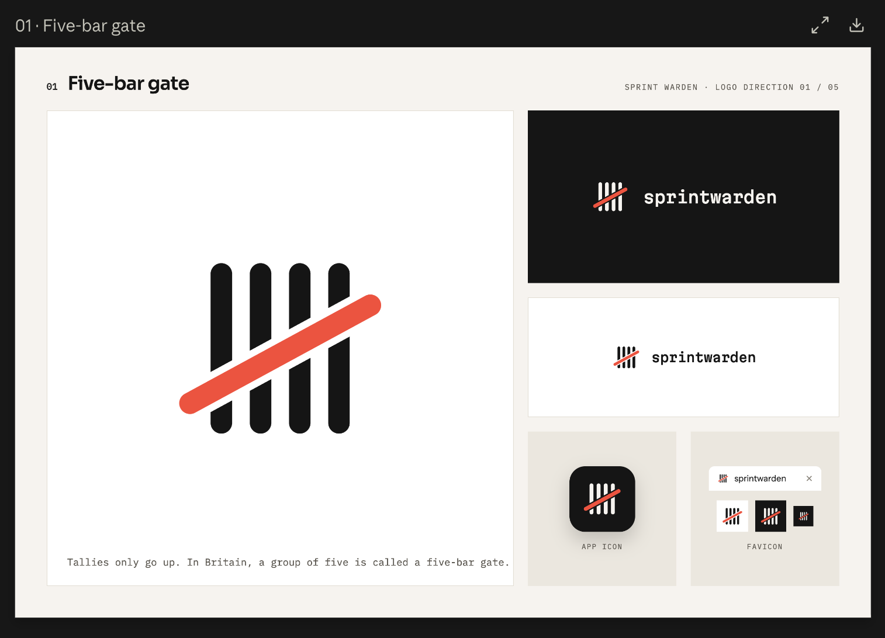

# sprintwarden brand kit



**The mark is the five-bar gate:** four tally bars with one red bar across them.
A tally only goes up, and in Britain a group of five drawn like this is called a
*five-bar gate*, which is also the name of the command that guards the count:
`sprint gate`. The red bar is the gate.

The design canvas with the other four directions:
https://claude.ai/artifact/Ff18Ky2x15JmX7489yLaNL (private until it is shared).

## What's in this folder

| path | what it is | use it for |
|---|---|---|
| `mark/sprintwarden-mark.svg` | the mark; bars in `currentColor`, gate in red | inline in HTML, so the bars follow the text colour in light and dark themes |
| `mark/sprintwarden-mark-ink.svg` · `-paper.svg` | the mark with fixed bar colours | light grounds (ink) and dark grounds (paper), anywhere CSS can't set the colour |
| `mark/*-512.png` | the same, transparent PNG | docs, slides, chat avatars |
| `wordmark/sprintwarden-wordmark.svg` | "sprintwarden" set in Martian Mono, outlined, `currentColor`, cropped to the letters | beside the inline mark, without loading a font |
| `lockup/sprintwarden-lockup.svg` | mark + wordmark, `currentColor` | inline |
| `lockup/sprintwarden-lockup-ink.svg` · `-paper.svg` (+ `-1200.png`) | mark + wordmark, fixed colours, text outlined | README header, social cards, slides |
| `app-icon/sprintwarden-app-icon.svg` (+ 1024/512/256/128 PNG) | ink rounded square (24% radius), paper bars | app icon, plugin or marketplace listings |
| `app-icon/sprintwarden-avatar-1024.png` | square ink tile, no rounding | GitHub org/repo avatar (GitHub crops it itself) |
| `favicon/favicon.svg` | ink tile, drawn on a 16 px grid | browser tab icon; crisp at 16, 32 and 48 px |
| `favicon/favicon.ico`, `favicon-16/32/48.png` | rasterised favicon (the .ico holds 16, 32, 48) | browsers that don't take SVG favicons |
| `favicon/apple-touch-icon.png` (180), `icon-192.png`, `icon-512.png` | home-screen and web-manifest icons | only if the dashboard ever gets a manifest |
| `fonts/MartianMono-Medium.woff2` | Martian Mono Medium (500), Latin subset, 10 KB | the wordmark on the web |
| `fonts/MartianMono-Medium.ttf` | the same, full character set | install it for Figma, Keynote and other apps |
| `fonts/OFL.txt` | the font's licence (SIL OFL 1.1) | must travel with the font files |
| `brand.css` | colour tokens, `@font-face`, `.sw-wordmark` | a starting point for any page that uses the brand |
| `design/five-bar-gate-board.png` | the chosen board from the canvas | reference |

## Rules

- **Colours.** Ink `#151515`, paper `#F6F3EE`, red `#FF4433`. The bars are ink on
  light grounds and paper on dark. The gate is always `#FF4433`, in both themes.
- **One red.** The gate is the only red in the mark. Don't use the brand red for
  status (pass/fail); the dashboard keeps its own `--bad` for failures.
- **Geometry.** The mark sits in a 120-unit square that already includes its clear
  space (about 8 units on each side). Don't crop into it, and keep at least that
  much room around it. The gate runs from lower left to upper right, on top of the bars, with
  a small knockout gap where it crosses them. Don't rotate, mirror, recolour the
  bars individually or drop the knockout.
- **Sizes.** Use the full mark at 20 px and up. Below 20 px use `favicon/favicon.svg`,
  which is redrawn on a pixel grid (the scaled-down mark turns grey at 16 px).
- **Wordmark.** One word, lowercase: `sprintwarden`. Martian Mono Medium (500),
  letter-spacing −0.02em. In running text write sprintwarden, the same as the README.
- **Lockup proportions** (from the board): mark box 56, gap 18, wordmark at
  23 px, centred on the mark. That is: text size = 0.41 × mark box, gap = 0.32 ×
  mark box.

## Adding it to the dashboard (`sprintwarden/ui`)

This section is written for whoever makes the change, human or agent. Read
the notes at the end before starting: two of the changes touch existing tests.

### 1. The header mark

`sprintwarden/ui/static/index.html` currently draws Lucide's shield:

```html
<a class="brand" href="#/" aria-label="sprintwarden, all projects"><span class="brand-mark" data-icon="shield-check"></span><span>sprintwarden</span></a>
```

Replace the shield span with the mark inline. It must not keep `data-icon`, or `app.js`
(line ~953) will swap it for a Lucide icon:

```html
<a class="brand" href="#/" aria-label="sprintwarden, all projects"><svg class="brand-mark" viewBox="0 0 120 120" aria-hidden="true" focusable="false"><path fill="currentColor" d="M24.5 22A5.5 5.5 0 0 1 35.5 22V66.07L24.5 72.05ZM24.5 92.54L35.5 86.56V98A5.5 5.5 0 0 1 24.5 98ZM44.5 22A5.5 5.5 0 0 1 55.5 22V55.2L44.5 61.18ZM44.5 81.67L55.5 75.69V98A5.5 5.5 0 0 1 44.5 98ZM64.5 22A5.5 5.5 0 0 1 75.5 22V44.33L64.5 50.31ZM64.5 70.8L75.5 64.82V98A5.5 5.5 0 0 1 64.5 98ZM84.5 22A5.5 5.5 0 0 1 95.5 22V33.46L84.5 39.44ZM84.5 59.93L95.5 53.95V98A5.5 5.5 0 0 1 84.5 98Z"/><path fill="#FF4433" d="M16.63 92.83L108.63 42.83A5.5 5.5 0 0 0 103.37 33.17L11.37 83.17A5.5 5.5 0 0 0 16.63 92.83Z"/></svg><span>sprintwarden</span></a>
```

In `style.css`, the mark is filled rather than stroked, and it needs at least 20 px:

```css
.brand .brand-mark { width: 22px; height: 22px; flex: none; }
```

The bars use `currentColor`, so they follow `--ink` through `.brand { color: var(--ink) }`
in light and dark themes without any extra CSS. Keep colours as SVG attributes:
the CSP (`style-src 'self'`) blocks `style="…"` attributes.

### 2. The favicon

Replace `sprintwarden/ui/static/favicon.svg` with the five-bar gate favicon. The
route is already in the `STATIC` whitelist in `server.py`, and `index.html`
already links it, so nothing else changes.

The SVG and PNG files in this folder carry a C2PA content-credentials block
(`<metadata>` with `xmlns:c2pa="http://c2pa.org/manifest"`), added when they were
exported. `test_S05_api_no_external_resources_in_static_files` rejects any
`http://` string in `static/` other than the SVG namespace, so copying
`favicon/favicon.svg` as it is will fail that test. Either write `static/favicon.svg`
from the source below, or get the human's OK to allow that namespace in the test.

```svg
<svg xmlns="http://www.w3.org/2000/svg" viewBox="0 0 16 16" width="32" height="32"><rect width="16" height="16" rx="3.5" fill="#151515"/><rect x="3" y="3" width="1" height="10" fill="#F6F3EE"/><rect x="6" y="3" width="1" height="10" fill="#F6F3EE"/><rect x="9" y="3" width="1" height="10" fill="#F6F3EE"/><rect x="12" y="3" width="1" height="10" fill="#F6F3EE"/><path d="M2 12L14 5" stroke="#151515" stroke-width="3.5" stroke-linecap="round"/><path d="M2 12L14 5" stroke="#FF4433" stroke-width="1.5" stroke-linecap="round"/></svg>
```

### 3. The wordmark (optional)

The header word is currently set in the system sans. To make it the Martian Mono
wordmark **without shipping a font file**, replace `<span>sprintwarden</span>`
with the contents of `wordmark/sprintwarden-wordmark.svg` as an inline
`<svg class="brand-word" … aria-hidden="true">`, and add:

```css
.brand .brand-word { height: 15px; width: auto; flex: none; }
```

The narrow-screen rule `.brand span:last-child { display: none; }` (style.css
~line 586) then needs to target `.brand .brand-word` instead.

Shipping the real font instead (to use Martian Mono for live text) takes three changes:
copy `fonts/MartianMono-Medium.woff2` into `static/` (top level; the server only
serves the files named in `STATIC`), add
`"/MartianMono-Medium.woff2": ("MartianMono-Medium.woff2", "font/woff2")` to
`STATIC`, and add the `@font-face` from `brand.css` to `style.css`. The CSP's
`default-src 'self'` already allows a same-origin font. Copy `fonts/OFL.txt` to
`sprintwarden/ui/LICENSE-martian-mono.txt`, next to `LICENSE-lucide.txt`.

### Notes before you start: tests and the ratchet

- **The favicon swap fails an existing test.** `tests/test_s07_board.py::test_S07_icons_every_status_mark_is_lucide_not_a_text_glyph`
  asserts that `favicon.svg` contains Lucide's shield-check path ("the favicon is
  Lucide's shield-check, like the brand mark"). Under this repo's own rules
  (AGENTS.md, rule 4) an agent must not weaken or rewrite that assertion on
  its own. The human has to approve changing it, for example to assert that the favicon and
  the header mark are both the five-bar gate.
- **Shipping the woff2 fails another.** `tests/test_s05_dashboard.py::test_S05_api_no_external_resources_in_static_files`
  reads every file in `static/` as UTF-8, so a binary font file makes it raise. The
  outlined wordmark (option above) avoids this; the font route needs the test to
  skip binary files, which again needs the human's OK.
- Steps 1 and 3 (outlined) touch no tests. Run `sprint gate` afterwards as usual.
- The README screenshots in `docs/` come from `docs/make_screenshots.py`; re-run
  it if the screenshots should show the new mark.

## Elsewhere

- **README header.** Show the lockup that matches the reader's theme on GitHub:

  ```html
  <picture>
    <source media="(prefers-color-scheme: dark)" srcset="brand/lockup/sprintwarden-lockup-paper.svg">
    
  </picture>
  ```

  PyPI doesn't resolve relative paths, so if the README is the package
  description, use the GitHub raw URL of the file there instead.
- **GitHub Action.** `action.yml` `branding.icon` only accepts Feather icon names,
  so it stays `shield` (the colour can become `red`).
- **GitHub avatar / social preview.** `app-icon/sprintwarden-avatar-1024.png`.

## Font licence

Martian Mono is © The Martian Mono Project Authors (Evil Martians), released under the
SIL Open Font License 1.1 with no Reserved Font Name; see `fonts/OFL.txt`. The
files here are the Medium instance (wght 500, wdth 100) of the variable font from
google/fonts. The `.woff2` is subset to Latin.
